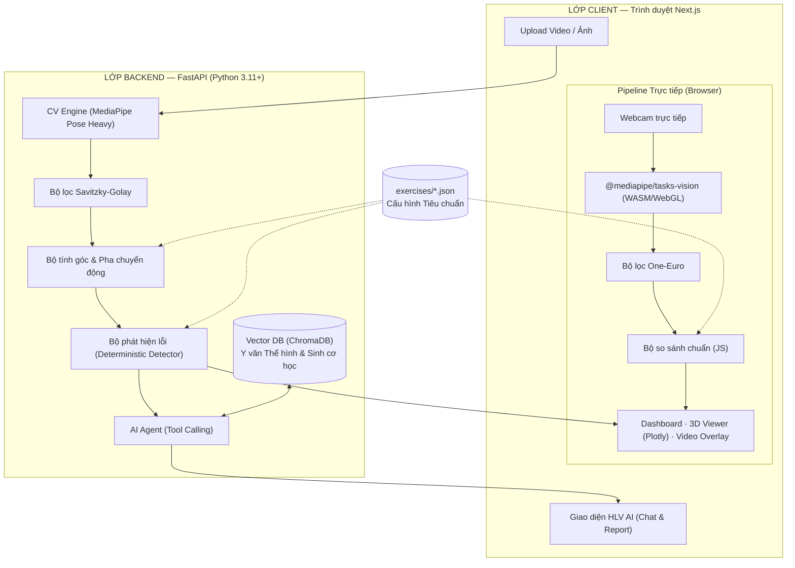

# ĐỒ ÁN PROJECT 3: Phân tích dữ liệu video và gợi ý chỉnh sửa động tác cho người tập gym

> **Học phần:** Project 3 (Đồ án 3) — Trường Công nghệ Thông tin và Truyền thông (SoICT), Đại học Bách khoa Hà Nội (HUST).  
> **Trạng thái:** Đã bảo vệ đề cương & được Giảng viên Hướng dẫn duyệt đề tài.  
> **Cập nhật:** 2026-10-13  
> **Loại tài liệu:** Đặc tả dự án kỹ thuật (Master Project Specification)

---

### Bộ tài liệu thiết kế chi tiết (Detailed Specifications in `docs/`):
* 📚 [1. Đặc tả Dataset & Kiến trúc 3 Tầng Mô hình AI](docs/01-dataset-and-models.md)
* 🏗️ [2. Kiến trúc Hệ thống Chi tiết & Luồng Dữ liệu Triển khai](docs/02-system-architecture.md)
* 📐 [3. Phân tích Thiết kế Hệ thống (UML & Database ERD)](docs/03-system-design-uml-db.md)

---

## Tóm tắt cốt lõi đề tài (Core Summary)

* **Tên đề tài:** Phân tích dữ liệu video và gợi ý chỉnh sửa động tác cho người tập gym
* **Đầu vào (Input):** Video quay từ camera điện thoại / webcam thông thường, hoặc hình ảnh tĩnh tại các tư thế mốc (setup, đáy động tác). Giới hạn trong phạm vi các bài tập gym (trọng tâm là **Squat**, mở rộng sang **Deadlift**, **Lunge**).
* **Quy trình xử lý (Process):** Từ video trích xuất tọa độ các khớp (joints/pose) theo chuỗi thời gian, lọc nhiễu tín hiệu, tính toán các góc sinh cơ học (gối, hông, lưng) và phân tách các pha động tác; sau đó **so sánh với chuẩn chỉ động tác (biomechanics benchmark)**.
* **Đầu ra (Output):** Xác định động tác đã chuẩn hay chưa (chấm điểm, phát hiện lỗi cụ thể theo frame), giải thích nguyên nhân và đưa ra **gợi ý chỉnh sửa form (coaching cues) kèm bài tập bổ trợ (corrective exercises)** thông qua trợ lý AI Agent.

---

## Mục lục

1. [Bối cảnh & Vấn đề](#1-bối-cảnh--vấn-đề)
2. [Đặc tả Input - Process - Output](#2-đặc-tả-input---process---output)
3. [Nguyên tắc thiết kế cốt lõi](#3-nguyên-tắc-thiết-kế-cốt-lõi)
4. [Kiến trúc tổng thể hệ thống](#4-kiến-trúc-tổng-thể-hệ-thống)
5. [Công nghệ sử dụng](#5-công-nghệ-sử-dụng)
6. [Pipeline kỹ thuật chi tiết](#6-pipeline-kỹ-thuật-chi-tiết)
7. [Mô-đun so sánh chuẩn & Bắt lỗi (Benchmark & Detector)](#7-mô-đun-so-sánh-chuẩn--bắt-lỗi-benchmark--detector)
8. [Trợ lý AI gợi ý chỉnh sửa (Agentic Framework + RAG)](#8-trợ-lý-ai-gợi-ý-chỉnh-sửa-agentic-framework--rag)
9. [Chế độ phản hồi trực tiếp (Live Feedback — Digital Mirror)](#9-chế-độ-phản-hồi-trực-tiếp-live-feedback--digital-mirror)
10. [Mở rộng bộ bài tập Gym](#10-mở-rộng-bộ-bài-tập-gym)
11. [Mô hình dữ liệu & Cấu hình bài tập](#11-mô-hình-dữ-liệu--cấu-hình-bài-tập)
12. [Cấu trúc thư mục đề xuất](#12-cấu-trúc-thư-mục-đề-xuất)
13. [Kiểm chứng & Đánh giá (Validation)](#13-kiểm-chứng--đánh-giá-validation)
14. [Lộ trình triển khai](#14-lộ-trình-triển-khai)
15. [Rủi ro & Biện pháp giảm thiểu](#15-rủi-ro--biện-pháp-giảm-thiểu)
16. [Tuyên bố miễn trừ trách nhiệm](#16-tuyên-bố-miễn-trừ-trách-nhiệm)

---

## 1. Bối cảnh & Vấn đề

### 1.1. Ba rào cản lớn của người tập gym phong trào
1. **Chấn thương do "điểm mù tư thế":** Trong tập gym (đặc biệt các bài tập phức hợp như Squat, Deadlift), người tập thường không thể tự nhìn thấy tư thế cột sống hay đầu gối của mình. Các lỗi sai lặp đi lặp lại (võng lưng, gập lưng dưới - butt wink, gối chụm trong - knee valgus) gây quá tải lên đĩa đệm và dây chằng, dẫn tới chấn thương mãn tính.
2. **Chi phí chuyên gia đắt đỏ:** Thuê Huấn luyện viên cá nhân (PT 1-1) có chứng chỉ quốc tế hoặc chuyên gia y học vận động rất tốn kém, không phải ai cũng có điều kiện duy trì lâu dài. Các video hướng dẫn trên mạng mang tính đại trà, không thể chỉ ra lỗi sai của từng cá nhân.
3. **Thiết bị đo đạc phòng lab quá xa xỉ:** Hệ thống Motion Capture quang học (như Vicon, Qualisys) trị giá hàng chục nghìn USD, yêu cầu dán nhiều điểm phản quang (markers) lên cơ thể và phòng lab chuyên dụng, không thể ứng dụng trong phòng gym thông thường.

### 1.2. Cơ hội kỹ thuật
* **Computer Vision (Pose Estimation):** Các mô hình như MediaPipe Pose cho phép trích xuất tọa độ không gian 3D của 33 điểm khớp nối cơ thể trực tiếp từ camera 2D thông thường với tốc độ chạy thời gian thực.
* **LLM & AI Agent:** Không chỉ dừng lại ở việc phát hiện lỗi cứng nhắc, AI Agent có thể truy xuất y văn thể hình (RAG) và đóng vai trò như một PT cá nhân, giải thích nguyên nhân và soạn bài tập phục hồi/cải thiện theo ngôn ngữ tự nhiên.

---

## 2. Đặc tả Input - Process - Output

Mô hình hóa chính xác theo yêu cầu đề tài đã được giảng viên duyệt:

```text
┌─────────────────────────┐      ┌─────────────────────────┐      ┌─────────────────────────┐
│         INPUT           │      │        PROCESS          │      │         OUTPUT          │
│ • Video camera          │ ───► │ • Khớp & Pose theo time │ ───► │ • Đánh giá Chuẩn / Lỗi  │
│ • Hình ảnh mốc (setup)  │      │ • Chuỗi góc sinh cơ học │      │ • Frame bằng chứng      │
│ • Phạm vi: Bài tập Gym  │      │ • So sánh Chuẩn chỉ     │      │ • AI gợi ý sửa form     │
└─────────────────────────┘      └─────────────────────────┘      └─────────────────────────┘
```

### 2.1. Input (Đầu vào)
* **Dữ liệu thô:**
  * Video quay lại quá trình thực hiện động tác (định dạng `.mp4`, `.mov`, khuyến nghị $\ge$ 30fps).
  * (Tùy chọn) Ảnh tĩnh chụp tại các thời điểm then chốt: vị trí vào thế (setup) hoặc vị trí đáy (bottom/deep squat).
* **Phạm vi động tác (Scope):**
  * **Trọng tâm (MVP - Phase 1):** **Squat** (Bodyweight Squat, Goblet Squat, Barbell Back Squat).
  * **Mở rộng (Phase 2):** **Deadlift** (Conventional/Romanian) và **Lunge** (chuyển động đơn phương).
* **Thông tin ngữ cảnh (Metadata người tập):** Chiều cao cơ thể (dùng để hiệu chuẩn tỉ lệ pixel $\rightarrow$ mét), góc quay camera (bên hông hoặc chính diện).

### 2.2. Process (Quy trình xử lý)
1. **Pose & Joint Extraction:** Nhận diện người trong khung hình, trích xuất 33 điểm mốc sinh học (landmarks) theo thời gian.
2. **Khử nhiễu & Tính toán hình học:** Lọc rung lắc dữ liệu bằng thuật toán Savitzky-Golay / One-Euro; tính toán chuỗi góc khớp (gối, hông, cổ chân, độ nghiêng thân).
3. **Phân tách pha chuyển động (Phase Segmentation):** Nhận diện điểm khởi đầu, pha hạ tạ (eccentric), điểm đảo chiều/đáy (bottom), pha đẩy lên (concentric), điểm kết thúc và đếm số lần lặp (reps).
4. **So sánh với Tiêu chuẩn (Benchmark Comparison):** Đối chiếu các góc đo được với tiêu chuẩn kỹ thuật sinh cơ học chuẩn (từ NSCA/ACSM) khai báo trong tệp cấu hình `exercises/<exercise>.json`.

### 2.3. Output (Đầu ra)
1. **Đánh giá chuẩn xác (Form Accuracy Assessment):**
   * Đạt / Chưa đạt từng lần lặp (Rep-by-rep assessment).
   * Danh sách lỗi vi phạm kèm chỉ số cụ thể (ví dụ: *Độ sâu đạt $105^\circ > 100^\circ$ khuyến nghị; Thân ngả $52^\circ > 45^\circ$*).
   * Video Overlay: Khung xương vẽ đè lên video gốc đổi màu trực quan (xanh lá = chuẩn, vàng/đỏ = lệch chuẩn) kèm link nhảy đến đúng frame bị lỗi (evidence frames).
2. **Gợi ý chỉnh sửa & Kế hoạch khắc phục (AI Coaching Guidance):**
   * **Phân tích cơ chế:** Tại sao lỗi này xuất hiện (ví dụ: gập lưng quá mức do cơ mông yếu hoặc cổ chân kém linh hoạt).
   * **Cues chỉnh tư thế:** Lời nhắc ngắn gọn khi tập (ví dụ: *"Gồng chặt bụng (brace core), mở ngực và đẩy sàn bằng gót chân"*).
   * **Bài tập bổ trợ (Corrective Exercises):** Gợi ý 2–3 bài tập kéo giãn hoặc bổ trợ kèm số set/rep cụ thể.

---

## 3. Nguyên tắc thiết kế cốt lõi

1. **Tách bạch ĐO LƯỜNG và SUY LUẬN (Deterministic Code vs. AI Reasoning):**
   * Thuật toán toán học (Detector) là người **duy nhất** quyết định *"Có lỗi gì, ở frame nào, lệch bao nhiêu độ"*.
   * LLM **tuyệt đối không tự suy diễn số liệu**. LLM chỉ nhận danh sách lỗi đã được code khẳng định, sau đó tra cứu cơ sở y văn (RAG) để viết lời giải thích và gợi ý bài tập sửa.
2. **Luật bài tập là DỮ LIỆU, không phải CODE (Data-Driven Configuration):**
   * Mọi tiêu chuẩn động tác, góc khớp cần theo dõi, ngưỡng lỗi đều nằm trong các file JSON khai báo (`exercises/squat.json`).
   * Backend và Frontend cùng đọc chung cấu hình này. Khi mở rộng sang môn/bài tập mới, chỉ cần thêm 1 file JSON và thư mục tài liệu RAG tương ứng.
3. **Ràng buộc điều kiện quay là tính năng (Quality Gatekeeping):**
   * Yêu cầu rõ góc quay camera phù hợp cho từng bài (Squat góc nghiêng $90^\circ$ để đo độ sâu và góc lưng; góc chính diện $0^\circ$ để đo gối chụm). Hệ thống kiểm tra chất lượng video tự động (fail fast) thay vì im lặng trả ra kết quả sai.
4. **Mọi số đo đều phải kiểm chứng sai số:**
   * Mọi chỉ số góc khớp đều được đánh giá qua tập dữ liệu kiểm chứng với mục tiêu sai số tuyệt đối trung bình $\text{MAE} < 5^\circ$.

---

## 4. Kiến trúc tổng thể hệ thống

Hệ thống được thiết kế theo kiến trúc **Dual-Runtime** kết hợp **Agentic Framework**:



### 4.1. Hai chế độ vận hành (Dual Runtime)

| Tiêu chí | Chế độ Phân tích Chuyên sâu (Offline) | Chế độ Gương Trực tiếp (Live Mirror) |
|---|---|---|
| **Mục đích** | Báo cáo chi tiết sau buổi tập, 3D tương tác, Chatbot | Sửa tư thế tức thì trong lúc đang tập |
| **Nơi xử lý** | Server Backend (Python FastAPI) | Client Trình duyệt (JavaScript / WASM) |
| **Đầu vào** | Video upload (.mp4, .mov) | Webcam luồng trực tiếp |
| **Mô hình Pose** | MediaPipe `pose_landmarker_heavy` | MediaPipe `pose_landmarker_lite` |
| **Bộ lọc** | Savitzky-Golay (non-causal, giữ biên độ cực trị) | One-Euro (causal, thích ứng vận tốc, trễ thấp) |
| **Độ trễ** | Vài giây (chấp nhận được) | **< 100 ms** (bắt buộc) |
| **Quyền riêng tư** | Upload lên server (xử lý xong có thể xóa) | **100% tại máy người dùng**, video không gửi qua mạng |

---

## 5. Công nghệ sử dụng

### 5.1. Backend (Python)
* **Web Framework:** FastAPI + Uvicorn (hiệu năng cao, tự sinh OpenAPI documentation).
* **Computer Vision:** `mediapipe` (Google Pose Landmarker), `opencv-python` (giải mã khung hình, render video overlay).
* **Toán học & Tín hiệu:** `numpy`, `scipy` (`savgol_filter`, `find_peaks`).
* **Validation dữ liệu:** `pydantic` v2 (schema chuẩn hóa dữ liệu I/O).
* **Vector Database:** `chromadb` (lưu trữ và tìm kiếm vector tài liệu y văn).
* **LLM & Agent:** Claude 3.5 Sonnet / OpenAI GPT-4o với tính năng Function Calling / Tool Calling.

### 5.2. Frontend (TypeScript)
* **Framework:** Next.js (App Router) + React + TypeScript.
* **UI & Styling:** Tailwind CSS, Lucide Icons, Shadcn UI.
* **Hiển thị 3D:** Plotly.js (`scatter3d`) hỗ trợ xoay 360 độ và đồng bộ timeline theo frame.
* **Biểu đồ 2D:** Recharts (đồ thị biến thiên góc khớp theo thời gian).
* **Real-time Pose:** `@mediapipe/tasks-vision` (chạy trên Web Worker).
* **Phản hồi âm thanh:** Web Speech API (Text-to-Speech có sẵn trên trình duyệt, không tốn phí API).

---

## 6. Pipeline kỹ thuật chi tiết

### 6.1. Thu thập & Trích xuất Khung xương (Joints Extraction)
MediaPipe Pose trích xuất **33 điểm mốc cơ thể**. Các điểm then chốt trong phân tích gym:
* **Hông (Hip):** Landmark 23 (trái), 24 (phải).
* **Đầu gối (Knee):** Landmark 25 (trái), 26 (phải).
* **Cổ chân (Ankle):** Landmark 27 (trái), 28 (phải).
* **Bàn chân & Gót:** Landmark 29/30 (heel), 31/32 (foot_index).
* **Thân trên:** Landmark 11/12 (vai - shoulder).

**Lưu ý kỹ thuật về hệ tọa độ:**
* `landmarks` (tọa độ pixel chuẩn hóa 2D): $x, y \in [0, 1]$, độ chính xác cao nhất, dùng để tính góc trong mặt phẳng chiếu (bên hông hoặc chính diện) và vẽ overlay.
* `world_landmarks` (tọa độ không gian 3D giả lập mét): dùng để vẽ mô hình 3D tương tác. Vì camera đơn có giới hạn về nhận biết chiều sâu (depth ambiguity), các góc đo cốt lõi sẽ ưu tiên tính trên mặt phẳng vuông góc trục camera.

### 6.2. Lọc làm mượt tín hiệu (Smoothing)
Dữ liệu khớp từ camera đơn thường có nhiễu rung (jitter). Hệ thống xử lý 3 bước:
1. **Nội suy khoảng trống:** Các frame có độ tin cậy `visibility < 0.5` được nội suy tuyến tính.
2. **Loại bỏ outlier:** Loại bỏ điểm nhảy vọt bất thường ($> 15\%$ kích thước khung hình trong 1 frame).
3. **Bộ lọc Savitzky-Golay:**
   $$\text{window\_length} = 11 \ (\approx \text{fps} / 5), \quad \text{polyorder} = 2$$
   *Lý do dùng Savitzky-Golay thay vì Moving Average:* Bộ lọc này bảo toàn cực đại/cực tiểu của chuyển động (điểm đáy của squat), không làm cụt độ sâu động tác.

### 6.3. Tính toán góc sinh cơ học
Góc tại khớp $B$ tạo bởi 3 điểm $A - B - C$:
$$\cos(\theta) = \frac{\vec{BA} \cdot \vec{BC}}{\|\vec{BA}\| \|\vec{BC}\|}, \quad \theta = \arccos(\text{clip}(\cos(\theta), -1.0, 1.0)) \times \frac{180}{\pi}$$

Các góc chủ đạo trong bài tập gym:
* **Góc gập gối (Knee Angle):** Hông – Gối – Cổ chân ($180^\circ$ là duỗi thẳng hoàn toàn).
* **Góc gập hông (Hip Angle):** Vai – Hông – Gối.
* **Độ nghiêng thân/lưng (Trunk Lean):** Vector Hông $\rightarrow$ Vai so với trục thẳng đứng.

### 6.4. Phân tách pha chuyển động (Phase Detection) cho Squat
1. **Tín hiệu đặc trưng:** Đồ thị biến thiên góc gối $\theta_{\text{knee}}(t)$.
2. **Pha Setup / Đứng thẳng:** $\theta_{\text{knee}} > 160^\circ$.
3. **Pha Eccentric (Hạ xuống):** Góc gối giảm liên tục.
4. **Pha Bottom (Đáy squat):** Điểm cực tiểu địa phương (`scipy.signal.find_peaks` trên đồ thị nghịch đảo $-\theta_{\text{knee}}$).
5. **Pha Concentric (Đẩy lên):** Góc gối tăng trở lại.
6. **Đếm rep bằng cơ chế ngưỡng có trễ (Hysteresis):** Xuống dưới $100^\circ$ và trở về trên $160^\circ$ được tính là 1 rep hoàn chỉnh (chống đếm trùng lặp do rung động).

---

## 7. Mô-đun so sánh chuẩn & Bắt lỗi (Benchmark & Detector)

Mỗi bài tập được mô tả bằng một bộ quy tắc logic so sánh trong `exercises/<exercise>.json`.

### 7.1. Bảng tiêu chuẩn so sánh cho bài SQUAT

| # | Tiêu chí so sánh | Chuẩn chỉ (Benchmark) | Lỗi lệch chuẩn | Mức độ nguy cơ |
|---|---|---|---|---|
| **1** | **Độ sâu (Squat Depth)** | Góc gối tại đáy $\le 100^\circ$ (nếp gấp hông ngang/thấp hơn đỉnh đầu gối) | $\theta_{\text{knee}} > 100^\circ$ tại pha đáy | Trung bình (chưa đạt biên độ tập) |
| **2** | **Độ nghiêng lưng (Trunk Lean)** | Thân trên nghiêng $\le 45^\circ$ so với phương thẳng đứng | Thân ngả $> 45^\circ$ khi xuống sâu | **Cao** (áp lực quá tải cột sống thắt lưng) |
| **3** | **Cong lưng dưới (Butt Wink)** | Góc uốn lượn cột sống giữ ổn định suốt rep | Góc hông thay đổi đột ngột ở cuối pha xuống | **Cao** (nguy cơ thoát vị đĩa đệm) |
| **4** | **Gối chụm vào trong (Knee Valgus)** | Đầu gối mở theo hướng mũi bàn chân (góc nhìn thẳng) | Khoảng cách 2 gối co hẹp lại so với 2 cổ chân khi đẩy lên | **Cao** (tổn thương dây chằng chéo ACL) |
| **5** | **Nhấc gót chân (Heel Lift)** | Toàn bộ bàn chân áp phẳng trên sàn | Tọa độ $y$ của gót nâng lên khỏi mặt phẳng sàn | Trung bình (cổ chân kém linh hoạt) |

### 7.2. Cấu trúc kết quả phát hiện lỗi (Detector Output)
Lớp Detector trả về JSON có cấu trúc rõ ràng:

```json
{
  "rep_id": 2,
  "status": "warning",
  "findings": [
    {
      "rule_id": "insufficient_depth",
      "name": "Chưa xuống đủ độ sâu",
      "severity": "medium",
      "measured_value": 112.5,
      "benchmark_value": 100.0,
      "unit": "degree",
      "evidence_frame": 142,
      "kb_tags": ["squat_depth", "range_of_motion", "quad_activation"]
    },
    {
      "rule_id": "excessive_trunk_lean",
      "name": "Thân trên ngả quá nhiều về trước",
      "severity": "high",
      "measured_value": 52.8,
      "benchmark_value": 45.0,
      "unit": "degree",
      "evidence_frame": 142,
      "kb_tags": ["lumbar_shear_stress", "spinal_safety", "core_bracing"]
    }
  ]
}
```

---

## 8. Trợ lý AI gợi ý chỉnh sửa (Agentic Framework + RAG)

### 8.1. Khung tác tử có công cụ (Tool-Calling Agent)
Khác với chatbot thông thường chỉ "nói suông", AI Agent hoạt động như một chuyên gia có quyền truy vấn các công cụ:

* `get_metrics(analysis_id)`: Lấy các thông số sinh cơ học (độ sâu trung bình, tempo, số reps).
* `get_findings(analysis_id)`: Lấy danh sách các lỗi do lớp Detector đã phát hiện.
* `get_frame_image(analysis_id, frame_idx)`: Lấy hình ảnh tại frame bị lỗi kèm khung xương đánh dấu đỏ.
* `search_knowledge_base(query, tags)`: Truy vấn Vector Database (ChromaDB) để trích xuất các nghiên cứu y văn và giáo trình NSCA/ACSM.

### 8.2. Cấu trúc phản hồi chuẩn của HLV AI
Mỗi gợi ý chỉnh sửa từ AI bắt buộc tuân theo cấu trúc 4 phần rõ ràng:

1. **Nhận định thực tế (Finding):** Chỉ ra chính xác lỗi ở rep nào, frame nào, lệch bao nhiêu so với chuẩn.
2. **Cơ chế & Tác động (Biomechanics Mechanism):** Giải thích áp lực cơ học lên cơ và khớp (dẫn nguồn y văn cụ thể).
3. **Khẩu lệnh điều chỉnh (Coaching Cues):** Hướng dẫn ngắn gọn dễ nhớ để người tập tự sửa ngay trong set tiếp theo (ví dụ: *"Tưởng tượng đang bẻ cong thanh đòn và ưỡn ngực lên"*).
4. **Bài tập bổ trợ khắc phục (Corrective Exercises):** Kê đơn 2–3 bài tập phụ trợ kèm số set/rep cụ thể (ví dụ: *Goblet Squat giữ 3s ở đáy*, *Giãn cơ bắp chuối với tường*).

---

## 9. Chế độ phản hồi trực tiếp (Live Feedback — Digital Mirror)

Mục tiêu đưa tính năng hỗ trợ ra ngay sàn tập thông qua chế độ **Gương kỹ thuật số**:

* **Xử lý tại Client:** Dùng `@mediapipe/tasks-vision` chạy trong Web Worker để giải phóng luồng giao diện UI.
* **Ngân sách độ trễ:** $< 100\text{ ms}$ (đo đạc thực tế $\approx 50-70\text{ ms}$).
* **Cảnh báo thị giác:** Khung xương vẽ đè thời gian thực đổi màu theo trạng thái (Xanh lá = Đúng, Vàng = Sắp lệch, Đỏ nhấp nháy = Vi phạm nghiêm trọng).
* **Cảnh báo âm thanh (Audio Cue):** Dùng Web Speech API phát câu lệnh ngắn bằng tiếng Việt: *"Xuống sâu thêm chút nữa!"*, *"Thẳng ngực lên!"*.
* **Cơ chế chống spam cảnh báo:**
  * Lỗi phải duy trì $\ge 300\text{ ms}$ mới kích hoạt (tránh nhiễu 1 frame).
  * Cooldown 3 giây giữa hai lần cảnh báo cùng một lỗi.

---

## 10. Mở rộng bộ bài tập Gym

Hệ thống được thiết kế theo kiến trúc mở (Plugin Architecture), dễ dàng mở rộng sang các bài tập gym khác:

| Bài tập | Góc quay khuyến nghị | Các khớp theo dõi chính | Lỗi điển hình phát hiện |
|---|---|---|---|
| **Squat** | $90^\circ$ (Ngang hông) & $0^\circ$ (Thẳng) | Gối, Hông, Cổ chân, Lưng | Xuống chưa sâu, ngả lưng quá nhiều, gối chụm trong |
| **Deadlift** | $90^\circ$ (Ngang hông) | Hông, Gối, Cột sống thắt lưng | Cong lưng (lumbar rounding), hông nhấc trước vai |
| **Lunge** | $90^\circ$ (Ngang thân) | Góc 2 đầu gối, Thân trên | Gối trước vượt quá mũi chân, thân ngả lệch bên |
| **Push-up / Bench Press** | $45^\circ$ hoặc $90^\circ$ | Khuỷu tay, Vai, Thân thẳng | Khuỷu tay xoè $90^\circ$ (ép khớp vai), võng lưng |

---

## 11. Mô hình dữ liệu & Cấu hình bài tập

### File cấu hình tiêu chuẩn: `exercises/squat.json`

```json
{
  "id": "squat",
  "name": "Barbell / Bodyweight Squat",
  "category": "gym_lower_body",
  "camera": {
    "recommended_views": ["side_90deg", "front_0deg"],
    "primary": "side_90deg",
    "min_fps": 30,
    "instruction": "Đặt điện thoại ngang tầm hông, cách 2-3m, quay trọn vẹn từ bên hông."
  },
  "joints_to_track": [
    { "id": "knee", "points": ["hip", "knee", "ankle"] },
    { "id": "hip", "points": ["shoulder", "hip", "knee"] },
    { "id": "trunk", "type": "vertical_angle", "points": ["hip", "shoulder"] }
  ],
  "phases": {
    "bottom": { "signal": "knee", "detect": "local_min", "prominence": 15 },
    "standing": { "signal": "knee", "detect": "local_max", "prominence": 15 }
  },
  "rep_counter": {
    "signal": "knee",
    "enter_bottom_threshold": 105,
    "exit_top_threshold": 160
  },
  "rules": [
    {
      "id": "insufficient_depth",
      "name": "Chưa xuống đủ sâu",
      "condition": { "metric": "knee_at_bottom", "op": ">", "value": 100 },
      "severity": "medium",
      "kb_tags": ["squat_depth", "range_of_motion"]
    },
    {
      "id": "excessive_trunk_lean",
      "name": "Thân ngả quá nhiều về trước",
      "condition": { "metric": "trunk_at_bottom", "op": ">", "value": 45 },
      "severity": "high",
      "kb_tags": ["lumbar_shear_stress", "spinal_safety"]
    }
  ]
}
```

---

## 12. Cấu trúc thư mục đề xuất

```
AI_Biomechanics_Coach/
├── PROJECT.md                      # Đặc tả dự án
├── README.md                       # Hướng dẫn cài đặt & Giới thiệu
│
├── backend/
│   ├── app/
│   │   ├── main.py                 # FastAPI Entrypoint
│   │   ├── api/                    # API Routes (upload, analysis, reports)
│   │   ├── core/                   # Mô-đun xử lý lõi (độc lập môn)
│   │   │   ├── pose.py             # Wrapper MediaPipe Pose Landmarker
│   │   │   ├── smoothing.py        # Savitzky-Golay & One-Euro filter
│   │   │   ├── geometry.py         # Tính toán góc vector, khoảng cách
│   │   │   ├── phases.py           # Phân tách pha chuyển động & đếm rep
│   │   │   └── detector.py         # Bộ máy so sánh luật & phát hiện lỗi
│   │   ├── exercises/              # File cấu hình tiêu chuẩn bài tập (JSON)
│   │   │   ├── squat.json
│   │   │   └── deadlift.json
│   │   ├── agent/                  # AI Coaching Agent
│   │   │   ├── tools.py            # Định nghĩa Tool-calling
│   │   │   ├── rag.py              # ChromaDB vector retriever
│   │   │   └── prompts.py          # System prompts cho HLV
│   │   └── models/                 # Pydantic Schemas
│   ├── knowledge/                  # Dữ liệu y văn PDF/Markdown cho RAG
│   ├── tests/                      # Unit tests & Fixtures
│   └── requirements.txt
│
├── frontend/
│   ├── app/                        # Next.js App Router (dashboard, live, history)
│   ├── components/
│   │   ├── Viewer3D.tsx            # Plotly 3D Skeleton tương tác
│   │   ├── VideoOverlay.tsx        # Trình xem video kèm khung xương & mốc lỗi
│   │   ├── MetricsDashboard.tsx    # Bảng chỉ số góc & đánh giá rep
│   │   ├── ChatPanel.tsx           # Khung chat với AI Coach
│   │   └── LiveMirror.tsx          # Gương phản hồi trực tiếp webcam
│   ├── lib/
│   │   ├── pose-worker.ts          # MediaPipe Web Worker
│   │   ├── one-euro.ts             # Thuật toán làm mượt JS
│   │   └── client-detector.ts      # Bộ kiểm tra lỗi tức thời trên browser
│   └── package.json
│
└── docs/
    └── validation-report.md        # Báo cáo thực nghiệm kiểm chứng sai số MAE
```

---

## 13. Kiểm chứng & Đánh giá (Validation)

Để đảm bảo yêu cầu học thuật của đồ án tại SoICT:
1. **Kiểm chứng độ chính xác góc khớp (MAE):**
   * Thu thập 10–15 video mẫu (gồm cả form chuẩn và form cố tình thực hiện sai).
   * Đo góc thủ công bằng phần mềm Kinovea / gán nhãn thủ công trên 100 frame ngẫu nhiên làm Ground Truth.
   * So sánh với góc tính toán tự động từ hệ thống.
   * **Chỉ tiêu nghiệm thu:** Sai số tuyệt đối trung bình $\text{MAE} < 5^\circ$ đối với góc gối và góc hông trong mặt phẳng chuẩn.
2. **Kiểm chứng đếm Rep & Phát hiện lỗi:**
   * Độ chính xác đếm rep đạt $\ge 95\%$.
   * Tỉ lệ nhận diện đúng lỗi (Precision & Recall) của lớp Detector đạt $\ge 90\%$.
3. **Đánh giá AI Agent:**
   * Đảm bảo $100\%$ các nhận định lỗi đều xuất phát từ danh sách `findings` của Detector (không có hiện tượng hallucination tự bịa lỗi).
   * Mọi lời khuyên sinh cơ học đều có trích dẫn từ nguồn tài liệu RAG đã nạp.

---

## 14. Lộ trình triển khai

| Tuần | Nội dung thực hiện | Kết quả bàn giao (Deliverables) |
|---|---|---|
| **Tuần 1–2** | Khởi tạo repo, dựng khung FastAPI + Next.js; xây dựng schema Pydantic và file cấu hình `squat.json`. | Môi trường dev sẵn sàng; API `/health` hoạt động. |
| **Tuần 3–4** | Triển khai CV Engine (MediaPipe), bộ lọc Savitzky-Golay, hàm tính góc hình học. | Trích xuất chuỗi góc làm mượt từ video mẫu. |
| **Tuần 5–6** | Triển khai bộ phân tách pha (Pha đáy, đứng), bộ đếm rep và lớp Detector so sánh tiêu chuẩn Squat. | Output JSON đánh giá Pass/Fail và danh sách lỗi. |
| **Tuần 7–8** | Xây dựng Frontend: Upload video, video overlay khung xương, vẽ đồ thị góc Recharts và dựng Plotly 3D Viewer. | Giao diện Web hiển thị kết quả phân tích trực quan. |
| **Tuần 9–10** | Tích hợp ChromaDB nạp tài liệu y văn gym; triển khai AI Agent hỗ trợ Tool-calling gợi ý bài tập sửa form. | Báo cáo phân tích tự động và Chatbot tương tác. |
| **Tuần 11** | Triển khai chế độ Live Feedback trên trình duyệt qua Web Worker và Web Speech API. | Gương kỹ thuật số phản hồi qua webcam. |
| **Tuần 12** | Tiến hành đo kiểm chứng sai số MAE, thu thập số liệu, viết báo cáo Đồ án 3 và hoàn thiện slide bảo vệ. | Báo cáo Đồ án 3 hoàn chỉnh + Video Demo. |

---

## 15. Rủi ro & Biện pháp giảm thiểu

| Rủi ro kỹ thuật | Mức độ | Biện pháp giảm thiểu |
|---|---|---|
| Sai số trục $Z$ (chiều sâu) của camera đơn lớn | Cao | Hạn chế đo trên trục $Z$; hướng dẫn người dùng quay đúng góc mặt phẳng ($90^\circ$ ngang hông hoặc $0^\circ$ chính diện). |
| Video người dùng bị rung lắc, ngược sáng | Cao | Bộ lọc tiền xử lý tự động cảnh báo và từ chối xử lý nếu độ tin cậy pose $< 80\%$. |
| AI Agent tự bịa lỗi (Hallucination) | Cao | Ràng buộc chặt chẽ bằng System Prompt: Agent chỉ được giải thích các lỗi có trong kết quả trả về của hàm `get_findings()`. |
| Trễ cao khi chạy webcam trực tiếp | Trung bình | Dùng model `pose_landmarker_lite` kết hợp Web Worker; bỏ qua frame cũ nếu bị dồn ứ (drop frame queue). |

---

## 16. Tuyên bố miễn trừ trách nhiệm

* Hệ thống được xây dựng nhằm mục đích **hỗ trợ học tập, phân tích kỹ thuật vận động và tối ưu hóa bài tập gym phong trào**.
* Kết quả phân tích **không phải là chẩn đoán y khoa** và không thay thế chỉ định của bác sĩ chuyên khoa cơ xương khớp hoặc chuyên gia y học thể thao.
