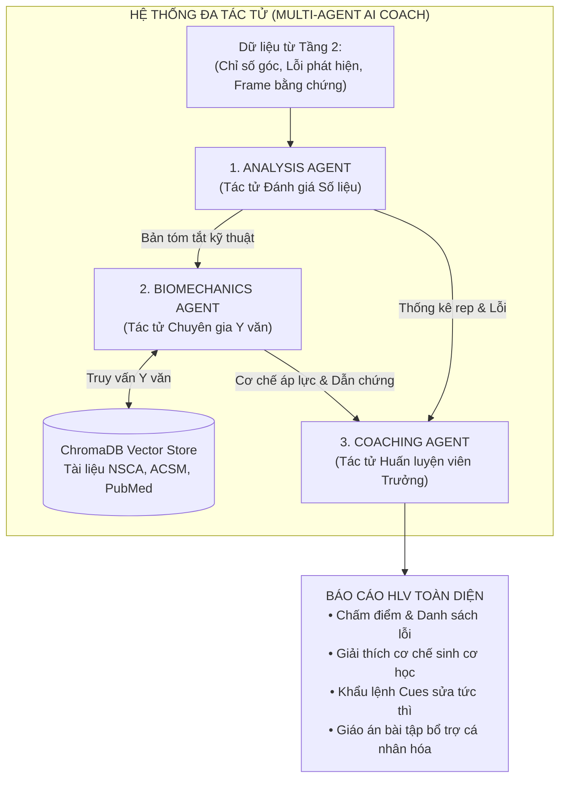

# ĐẶC TẢ CHI TIẾT: BÀI TOÁN DỮ LIỆU & KIẾN TRÚC MÔ HÌNH AI


---

## 1. TỔNG QUAN KIẾN TRÚC 3 TẦNG MÔ HÌNH

Hệ thống phân tách bài toán AI thành 3 tầng chức năng độc lập:

```text
┌────────────────────────────────────────────────────────────────────────┐
│ TẦNG 1: TRÍCH XUẤT KHUNG XƯƠNG (Pose Estimation)                       │
│ Công nghệ: MediaPipe Pose (Pre-trained) ──► Trích xuất 33 khớp 3D      │
└───────────────────────────────────┬────────────────────────────────────┘
                                    │ Tọa độ Khớp (x, y, z) theo time
                                    ▼
┌────────────────────────────────────────────────────────────────────────┐
│ TẦNG 2: PHÂN LOẠI & ĐÁNH GIÁ ĐỘNG TÁC (Biomechanics + Light ML)        │
│ Kết hợp: Vector đặc trưng góc sinh cơ học + Mô hình Học máy nhẹ         │
│ (SVM / Random Forest / XGBoost / 1D-CNN) ──► Phân loại Pass/Fail & Lỗi  │
└───────────────────────────────────┬────────────────────────────────────┘
                                    │ Danh sách lỗi định lượng + Frame mốc
                                    ▼
┌────────────────────────────────────────────────────────────────────────┐
│ TẦNG 3: TRỢ LÝ HLV ĐA TÁC TỬ (Multi-Agent System + RAG)                │
│ Phối hợp: Analysis Agent + Biomechanics RAG Agent + Coaching Agent     │
│ ──► Giải thích nguyên nhân, đưa ra khẩu lệnh Cues & Bài tập bổ trợ     │
└────────────────────────────────────────────────────────────────────────┘
```

---

## 2. TẦNG 1: TRÍCH XUẤT KHUNG XƯƠNG (POSE ESTIMATION)

### 2.1. Chiến lược mô hình: Kế thừa Pre-trained Model
* **Lý do không tự train:** Bài toán bắt điểm mốc cơ thể người (Human Pose Estimation) từ ảnh RGB 2D đã được giải quyết rất tốt bởi các phòng lab hàng đầu thế giới với hàng triệu ảnh gán nhãn thủ công (COCO, MPII, DensePose). Việc tự train từ đầu tốn hàng tháng tính toán và không cần thiết cho mục tiêu của Project 3.
* **Lựa chọn công nghệ:** **MediaPipe Pose Landmarker** (Google).
  * Chế độ **Heavy** cho phân tích video tải lên (ưu tiên độ chính xác).
  * Chế độ **Lite** cho phản hồi trực tiếp thời gian thực qua webcam trên trình duyệt (ưu tiên tốc độ).
* **Đầu ra:** 33 điểm mốc sinh học với tọa độ chuẩn hóa $(x, y) \in [0, 1]$, độ sâu tương đối $z$, và độ tin cậy $visibility \in [0, 1]$.

### 2.2. Xử lý giới hạn trục Z (Độ sâu)
* Do thu nhận từ một camera 2D thông thường, trục Z là kết quả ước lượng từ mô hình học sâu (depth estimation), có sai số cao hơn tọa độ X và Y.
* **Giải pháp kỹ thuật:** 
  * Chỉ tính các góc sinh cơ học trên **mặt phẳng 2D vuông góc với trục quang camera** (ví dụ: quay góc nghiêng $90^\circ$ ngang hông để tính góc gập gối, gập hông và độ nghiêng lưng).
  * Tọa độ không gian 3D (`world_landmarks`) chỉ dùng để hiển thị mô hình trực quan cho người dùng xoay 360 độ trên giao diện web.

---

## 3. TẦNG 2: ĐÁNH GIÁ ĐỘNG TÁC (BIOMECHANICS + HỌC MÁY NHẸ)

Thay vì để mạng nơ-ron học thẳng từ ảnh gốc (dễ bị nhiễu bởi quần áo, ánh sáng, hậu cảnh phòng gym), ta sử dụng cách tiếp cận **Feature-based Machine Learning**: Biến đổi tọa độ khớp thành các đặc trưng sinh cơ học, sau đó đưa vào mô hình học máy nhẹ.

### 3.1. Kỹ nghệ Đặc trưng (Feature Engineering từ Chuỗi thời gian)

Từ chuỗi tọa độ khớp qua từng frame, ta trích xuất vector đặc trưng $F_{\text{rep}}$ cho mỗi rep động tác:

| Nhóm đặc trưng | Tên đại lượng | Ý nghĩa sinh cơ học |
|---|---|---|
| **Góc cực trị** | $\min(\theta_{\text{knee}})$, $\min(\theta_{\text{hip}})$ | Đo độ sâu khi xuống đáy (Squat Depth) |
| **Góc thân người** | $\max(\theta_{\text{trunk}})$ tại pha đáy | Đo độ gập/ngả thân trên về phía trước |
| **Biến thiên góc** | $\Delta \theta_{\text{spine}}$ (cột sống) | Đo độ uốn cong lưng dưới (Butt wink) |
| **Khoảng cách tương đối**| $\text{dist}(\text{knee\_L}, \text{knee\_R}) / \text{dist}(\text{ankle\_L}, \text{ankle\_R})$ | Tỉ lệ co hẹp đầu gối phát hiện Knee Valgus |
| **Thời gian & Vận tốc** | $T_{\text{eccentric}}, T_{\text{concentric}}, \text{Ratio}_{\text{tempo}}$ | Tốc độ hạ tạ và đẩy tạ lên (Tempo) |
| **Chuỗi góc chuẩn hóa** | Mẫu nội suy 30 điểm thời gian $\theta_{\text{knee}}(t_{1..30})$ | Đường cong quỹ đạo chuyển động chuẩn hóa |

### 3.2. Lựa chọn Mô hình Học máy nhẹ
* **Mô hình triển khai:** 
  * **XGBoost / Random Forest:** Dành cho vector đặc trưng tổng hợp của từng rep (dễ huấn luyện, không cần GPU, giải thích được mức độ quan trọng của đặc trưng - Feature Importance).
  * **1D-CNN hoặc Bi-LSTM:** Nhận đầu vào là chuỗi góc chuẩn hóa 30 bước thời gian (shape $[30, \text{num\_angles}]$) để phân loại chuỗi thời gian chuyển động.
* **Nhiệm vụ của mô hình (Target Outputs):**
  1. **Bài toán 1 - Phân loại Form (Binary Classification):** Đạt chuẩn (Good Form) vs Lỗi (Bad Form).
  2. **Bài toán 2 - Định danh loại lỗi (Multi-label Classification):**
     * `insufficient_depth` (Xuống chưa đủ sâu)
     * `excessive_trunk_lean` (Lưng ngả quá nhiều)
     * `knee_valgus` (Gối chụm vào trong)
     * `butt_wink` (Cong lưng dưới khi xuống sâu)
     * `heel_lift` (Nhấc gót chân)

### 3.3. Cơ chế Hybrid (Kết hợp Học máy + Luật Sinh cơ học)
Để đảm bảo kết quả có thể giải thích được 100% (Explainability) và không bị lỗi vô lý:
* Nếu Mô hình ML báo lỗi `insufficient_depth` với độ tin cậy $> 0.8$, hệ thống đối chiếu với luật ngưỡng: *Góc gối đo được là $112^\circ$ (ngưỡng chuẩn $\le 100^\circ$)*. 
* Sự kết hợp này mang lại 2 lợi ích:
  * **Độ chính xác cao:** ML nhận diện được các dạng hình thái chuyển động phức tạp.
  * **Tính minh bạch:** Trả về con số góc lệch cụ thể để người tập biết mình sai bao nhiêu độ.

---

## 4. CHI TIẾT NGUỒN DATASET CHO TẦNG 2

Để huấn luyện và kiểm chứng mô hình ở Tầng 2, đồ án kết hợp **3 nguồn dữ liệu**:

```text
┌────────────────────────────────────────────────────────────────────────┐
│ NGUỒN 1: BỘ DỮ LIỆU CÔNG KHAI (Public Academic Datasets)              │
│ Fit3D, RepCount Dataset, Kaggle Gym Exercises                          │
│ ──► Dùng để tiền huấn luyện và học các dạng chuyển động chung          │
└───────────────────────────────────┬────────────────────────────────────┘
                                    │
┌───────────────────────────────────▼────────────────────────────────────┐
│ NGUỒN 2: BỘ DỮ LIỆU TỰ THU THẬP (Self-Collected HUST Dataset)          │
│ 30–50 video quay sinh viên tập đúng và cố tình tập sai form            │
│ ──► Dùng để tinh chỉnh (Fine-tuning) & Kiểm thử thực tế                │
└───────────────────────────────────┬────────────────────────────────────┘
                                    │
┌───────────────────────────────────▼────────────────────────────────────┐
│ NGUỒN 3: TẬP DỮ LIỆU GÁN NHÃN ĐO TAY (Validation Ground Truth)         │
│ 100 frame đo góc thủ công bằng phần mềm Kinovea                        │
│ ──► Dùng để đo sai số MAE góc khớp (Chỉ tiêu nghiệm thu SoICT)         │
└────────────────────────────────────────────────────────────────────────┘
```

### 4.1. Các Bộ dữ liệu Công khai (Public Datasets)
1. **Fit3D Dataset (Max Planck Institute):**
   * Chứa các bài tập gym (Squat, Deadlift, Lunge) được ghi hình đồng thời bằng camera RGB và hệ thống Motion Capture chuyên dụng.
   * Dùng để kiểm chứng tọa độ khớp 3D và các mốc góc chuẩn.
2. **RepCount Dataset (CVPR Workshop):**
   * Tập dữ liệu lớn gồm hàng nghìn video tập luyện thể hình tải từ YouTube, có gán nhãn điểm bắt đầu, điểm đáy và điểm kết thúc của từng rep.
   * Dùng để huấn luyện thuật toán phân tách pha và đếm số rep.
3. **Kaggle Squat Pose Analysis Datasets:**
   * Các bộ dữ liệu cộng đồng gán nhãn nhị phân (Correct vs. Incorrect Squat) và các lỗi phổ biến.

### 4.2. Bộ Dữ liệu Tự Thu thập (Self-Collected Dataset)
* **Kế hoạch thu thập:**
  * Đối tượng: 4–6 sinh viên nam/nữ với thể trạng và chiều cao khác nhau.
  * Thiết bị: Điện thoại thông minh (iPhone/Android), độ phân giải 1080p, tốc độ 30fps và 60fps.
  * Góc quay: $90^\circ$ ngang hông (khoảng cách 2.5m) và $0^\circ$ chính diện.
* **Kịch bản thực hiện (Protocol):**
  * Mỗi người thực hiện 3 set, mỗi set 5 reps:
    * Set 1: Động tác chuẩn chỉ (Full ROM, lưng thẳng, gối mở).
    * Set 2: Cố tình mắc lỗi độ sâu (Half squat, gối $> 110^\circ$).
    * Set 3: Cố tình mắc lỗi tư thế lưng (ngả người nhiều, uốn cong cột sống).
* **Quy trình gán nhãn (Annotation):**
  * Ghi lại nhãn cho từng Rep: `[rep_id, start_frame, bottom_frame, end_frame, label_pass_fail, list_of_faults]`.

### 4.3. Tăng cường Dữ liệu (Data Augmentation) cho Chuỗi Khớp
Vì làm việc trên tọa độ khớp chứ không phải ảnh pixel, các phép tăng cường dữ liệu bao gồm:
* **Lật gương (Horizontal Flip):** Đổi vai trò khớp trái $\leftrightarrow$ khớp phải để nhân đôi dữ liệu.
* **Co giãn thời gian (Time Warping):** Tăng/giảm tốc độ thực hiện rep bằng cách nội suy thời gian ($\pm 15\%$).
* **Nhiễu Gaussian nhẹ:** Thêm nhiễu $\mathcal{N}(0, \sigma^2)$ vào tọa độ khớp để mô hình chống rung tốt hơn.

---

## 5. TẦNG 3: TRỢ LÝ HLV ĐA TÁC TỬ (MULTI-AGENT SYSTEM + RAG)

Thay vì dùng 1 prompt LLM duy nhất (dễ bị quá tải và trả lời chung chung), hệ thống sử dụng kiến trúc **3 Tác tử phối hợp (Multi-Agent Collaboration)**:



### 5.1. Vai trò của từng Agent
1. **Analysis Agent (Tác tử Đánh giá):**
   * *Nhiệm vụ:* Đọc mảng JSON kết quả từ Tầng 2, tính toán thống kê (tổng rep, tỉ lệ đạt chuẩn, biên độ sâu trung bình, phân bố lỗi qua các hiệp tập).
   * *Đặc điểm:* Chỉ làm việc với số liệu, không phát biểu cảm tính.
2. **Biomechanics Agent (Tác tử Chuyên gia Y văn & RAG):**
   * *Nhiệm vụ:* Nhận danh sách lỗi từ Analysis Agent, sau đó truy vấn Vector Database (ChromaDB) để tìm các bài báo khoa học hoặc giáo trình NSCA liên quan đến cơ chế gây chấn thương (ví dụ: lực cắt tác động lên đĩa đệm L4-L5 khi thân gập $> 45^\circ$).
   * *Đặc điểm:* Cung cấp cơ sở khoa học chính xác và trích dẫn nguồn uy tín.
3. **Coaching Agent (Tác tử Huấn luyện viên Trưởng):**
   * *Nhiệm vụ:* Đóng vai trò là người giao tiếp chính với người tập. Tổng hợp phân tích từ 2 tác tử trên để chuyển hóa thành ngôn ngữ huấn luyện dễ hiểu:
     * Cung cấp **Khẩu lệnh điều chỉnh (Coaching Cues)** ngắn gọn, dễ nhớ khi tập (ví dụ: *"Tưởng tượng đang bẻ cong thanh đòn và ưỡn ngực lên"*).
     * Soạn **Bài tập bổ trợ (Corrective Exercises)** để xử lý nguyên nhân gốc rễ (ví dụ: gập lưng do yếu cơ mông $\rightarrow$ bài tập Glute Bridge, Goblet Squat).
     * Phụ trách khung Chat tương tác 1-1 để giải đáp thắc mắc người dùng.

### 5.2. Cơ sở Tri thức RAG (Knowledge Base Setup)
* **Tài liệu nguồn:**
  * *Essentials of Strength Training and Conditioning* (NSCA).
  * Các bài báo khoa học Open-Access trên PubMed Central về sinh cơ học bài Squat (*"Kinematic Analysis of the Back Squat"*, *"Knee Biomechanics during Squatting"*).
* **Pipeline xử lý tài liệu:**
  * Cắt đoạn (Chunking): 400–600 tokens kèm metadata (`exercise`, `fault_type`, `anatomy_joint`).
  * Embedding Model: `text-embedding-3-small` (OpenAI) hoặc mô hình mã nguồn mở `bge-small-en-v1.5`.
  * Lưu trữ: ChromaDB nhúng trực tiếp trong Backend FastAPI.
