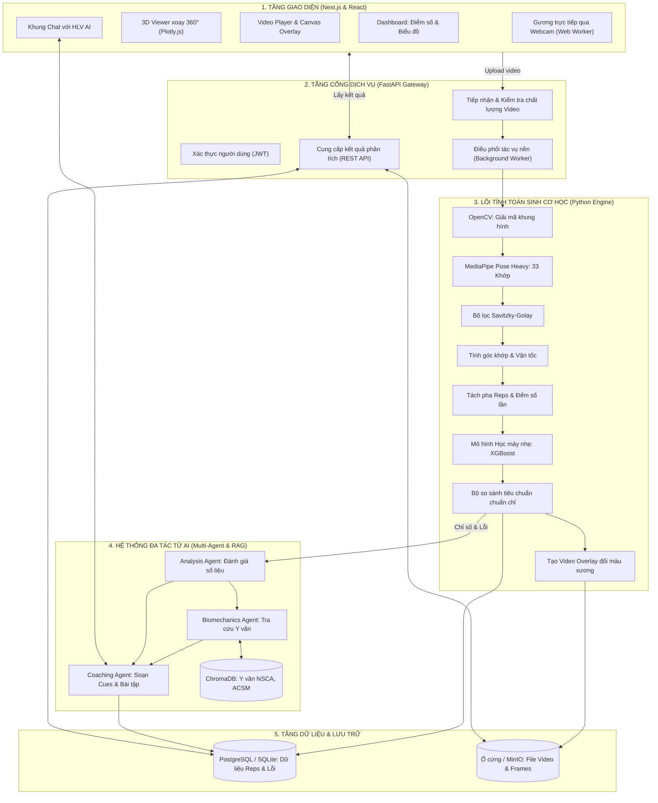
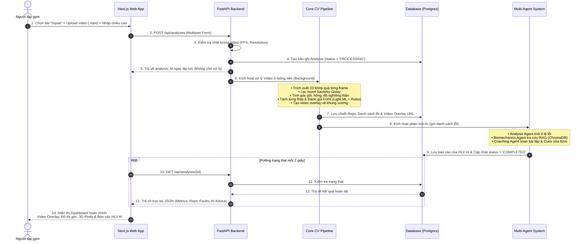

# ĐẶC TẢ CHI TIẾT: KIẾN TRÚC HỆ THỐNG & LUỒNG DỮ LIỆU TRIỂN KHAI


---

## 1. TỔNG QUAN KIẾN TRÚC HỆ THỐNG (SYSTEM ARCHITECTURE)

Hệ thống được thiết kế theo mô hình **Kiến trúc Đa tầng (Multi-tier Architecture)** kết hợp cơ chế **Dual-Runtime** (Vừa hỗ trợ phân tích chuyên sâu trên Server, vừa hỗ trợ phản hồi trực tiếp thời gian thực trên Client).

### 1.1. Sơ đồ Kiến trúc Tổng thể



---

## 2. GIẢI THÍCH CHI TIẾT CÁC TẦNG TRONG HỆ THỐNG

Để báo cáo mạch lạc với thầy cô, bạn có thể diễn giải kiến trúc theo 5 tầng chức năng:

### 2.1. Tầng 1: Trình duyệt / Giao diện người dùng (Presentation Layer)
* **Công nghệ:** Next.js 14 (App Router), TypeScript, Tailwind CSS.
* **Nhiệm vụ:**
  * Nhận video người tập upload lên hoặc trực tiếp bắt hình ảnh từ webcam.
  * Hiển thị bảng điều khiển (Dashboard) trực quan: chấm điểm toàn bộ bài tập (0–100 điểm), số rep đạt chuẩn/lỗi, đồ thị biến thiên góc khớp qua thời gian (Recharts).
  * Hiển thị trình xem 3D xoay 360 độ (Plotly.js) đồng bộ khung xương với từng frame video.
  * Khung chat hỏi đáp kỹ thuật với Huấn luyện viên AI.

### 2.2. Tầng 2: Cổng Dịch vụ (API Gateway - FastAPI)
* **Công nghệ:** Python 3.11+, FastAPI, Uvicorn, Pydantic v2.
* **Nhiệm vụ:**
  * Cung cấp các RESTful APIs chuẩn OpenAPI/Swagger.
  * Kiểm tra chất lượng đầu vào của video (Validation Gatekeeper): Kiểm tra độ phân giải $\ge 720p$, FPS $\ge 30$, độ dài $3 - 60$ giây. Nếu không đạt thì từ chối ngay lập tức để tránh xử lý dữ liệu rác.
  * Đẩy tác vụ xử lý video vào hàng đợi nền (Background Worker) để không làm treo giao diện người dùng.

### 2.3. Tầng 3: Lõi Xử lý Thị giác máy tính & Sinh cơ học (Core Pipeline)
Đây là "trái tim kỹ thuật" của đồ án:
1. **OpenCV:** Giải mã video thành chuỗi ảnh (frame-by-frame).
2. **MediaPipe Pose Heavy:** Trích xuất 33 tọa độ khớp cho từng frame.
3. **Savitzky-Golay Filter:** Làm mượt tín hiệu tọa độ, khử rung lắc camera mà không làm mất đi các đỉnh/đáy góc chuyển động.
4. **Kinematics Engine:** Tính toán các góc sinh cơ học quan trọng (góc gập gối, góc gập hông, độ nghiêng thân trên so với phương thẳng đứng).
5. **Phase Segmentation:** Tách từng lần lặp (Rep) dựa trên chu kỳ góc gối bằng thuật toán `find_peaks` kết hợp cơ chế trễ (Hysteresis) để đếm rep chính xác.
6. **Mô hình Học máy nhẹ (XGBoost/1D-CNN):** Đánh giá đặc trưng động tác và phân loại lỗi.
7. **Rule Engine:** Đối chiếu các góc đo được với tiêu chuẩn sinh cơ học trong file cấu hình `exercises/squat.json` để xác định chính xác số độ bị lệch.
8. **Overlay Video Generator:** Dùng OpenCV vẽ khung xương trực quan đè lên video gốc (đổi màu xanh lá khi chuẩn, đỏ khi sai) và lưu lại.

### 2.4. Tầng 4: Hệ thống Đa tác tử AI (Multi-Agent & RAG Layer)
* **Công nghệ:** LangChain / Tool-calling, Vector DB ChromaDB, Mô hình LLM (Claude 3.5 Sonnet / GPT-4o).
* **Nhiệm vụ:**
  * **Analysis Agent:** Tổng hợp báo cáo thống kê các rep và xác định lỗi nghiêm trọng nhất.
  * **Biomechanics Agent:** Tìm kiếm tài liệu y văn từ ChromaDB để giải thích cơ chế gây chấn thương (ví dụ: gập lưng quá mức làm tăng áp lực đĩa đệm thắt lưng).
  * **Coaching Agent:** Chuyển hóa kiến thức khoa học thành lời khuyên tập luyện thân thiện, cung cấp khẩu lệnh chỉnh tư thế (coaching cues) và bài tập phục hồi/bổ trợ.

### 2.5. Tầng 5: Dữ liệu & Lưu trữ (Data & Storage Layer)
* **Cơ sở dữ liệu quan hệ (PostgreSQL / SQLite):** Lưu trữ thông tin người dùng, kết quả từng bài phân tích, chi tiết từng rep và danh sách các lỗi vi phạm.
* **Kho lưu trữ tệp (Local File System / MinIO):** Lưu video gốc, video overlay sau khi vẽ khung xương, và các ảnh frame cắt ra làm bằng chứng lỗi.

---

## 3. LUỒNG DỮ LIỆU TRIỂN KHAI (END-TO-END DATA FLOW)

Dưới đây là hành trình của dữ liệu từ lúc người dùng bắt đầu tải video cho đến khi nhận được kết quả phân tích:



---

## 4. BẢN CHẤT KIẾN TRÚC DUAL-RUNTIME: OFFLINE VS LIVE

Hệ thống hỗ trợ 2 chế độ xử lý hoàn toàn khác biệt để giải quyết 2 bài toán thực tế:

```text
┌──────────────────────────────────────┐      ┌──────────────────────────────────────┐
│ CHẾ ĐỘ PHÂN TÍCH OFFLINE (SERVER)    │      │ CHẾ ĐỘ GƯƠNG TRỰC TIẾP (CLIENT LIVE) │
├──────────────────────────────────────┤      ├──────────────────────────────────────┤
│ • Đầu vào: File video tải lên        │      │ • Đầu vào: Webcam trực tiếp          │
│ • Nơi chạy: Server Backend Python    │      │ • Nơi chạy: 100% Trình duyệt Client  │
│ • Ưu tiên: ĐỘ CHÍNH XÁC CAO NHẤT     │      │ • Ưu tiên: ĐỘ TRỄ THẤP NHẤT (<100ms) │
│ • Model: MediaPipe Heavy             │      │ • Model: MediaPipe Lite (WASM)       │
│ • Bộ lọc: Savitzky-Golay             │      │ • Bộ lọc: One-Euro Filter            │
│ • Đầu ra: Video 3D, Đồ thị, Báo cáo  │      │ • Đầu ra: Khung xương đổi màu, Voice │
│ • Độ trễ: Vài giây (chấp nhận được)  │      │ • Quyền riêng tư: Video không rời máy│
└──────────────────────────────────────┘      └──────────────────────────────────────┘
```

### Tại sao Chế độ Live phải chạy 100% trên Trình duyệt?
1. **Tiết kiệm độ trễ mạng (Network Latency = 0ms):** Nếu stream từng frame qua mạng lên server rồi chờ phản hồi, độ trễ round-trip cộng thời gian encode/decode video sẽ vượt quá 300ms, khiến người tập không thể điều chỉnh tư thế ngay lập tức. Chạy WebAssembly (WASM) trên GPU client cho độ trễ tổng cộng chỉ $\approx 50-70\text{ ms}$.
2. **Bảo mật & Quyền riêng tư (Privacy-by-Design):** Khi người tập tự tập tại phòng riêng hoặc phòng gym, hình ảnh webcam trực tiếp **không bao giờ rời khỏi thiết bị của họ**, xóa tan mọi lo ngại về lộ hình ảnh cá nhân.
