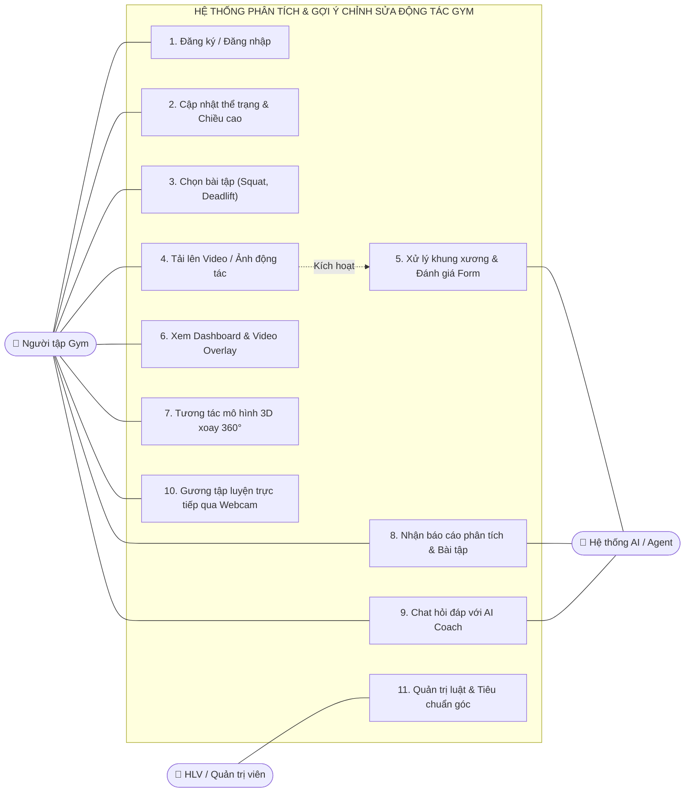
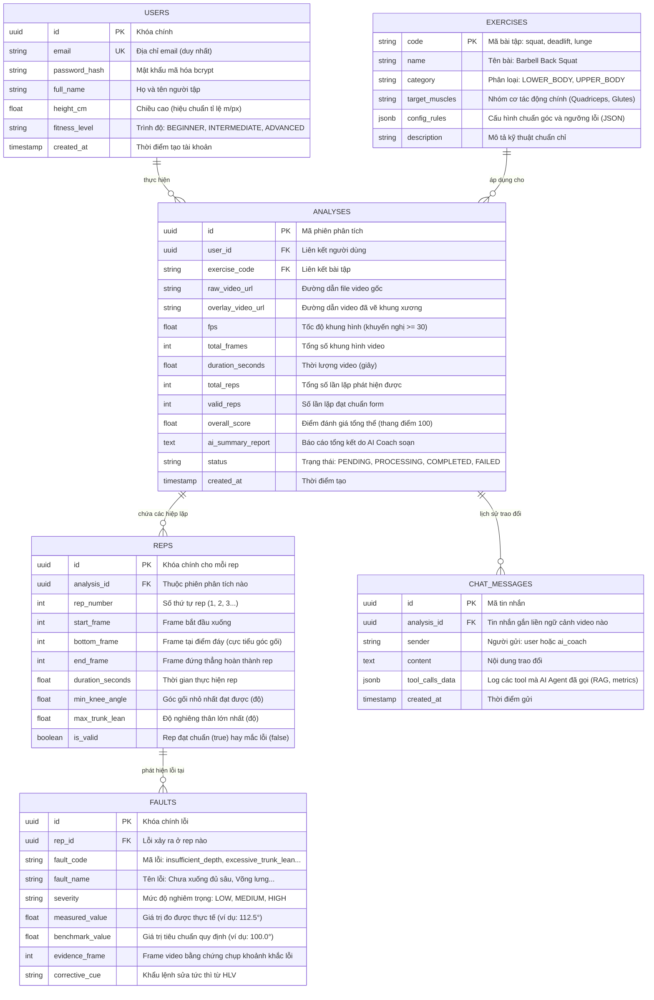
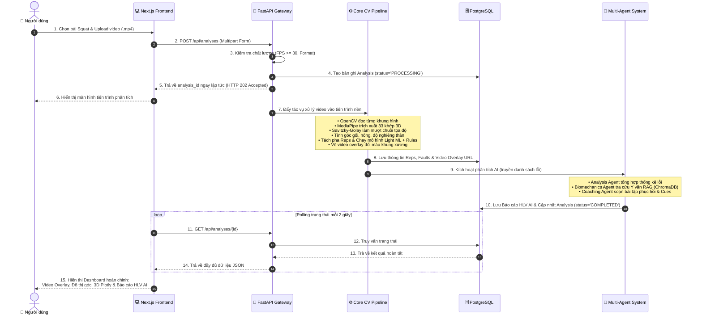
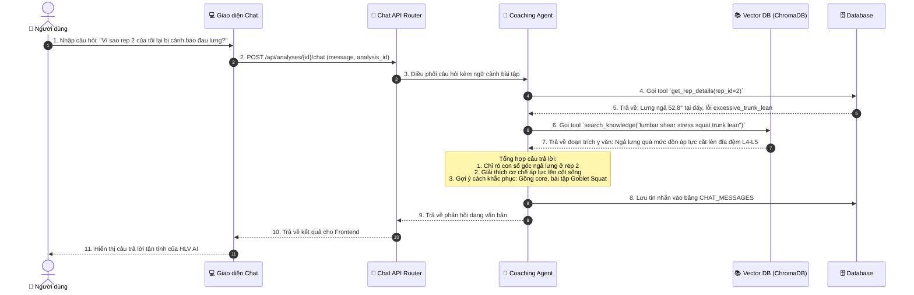
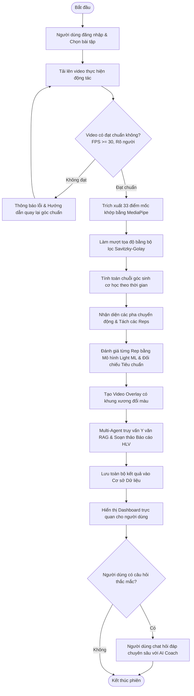
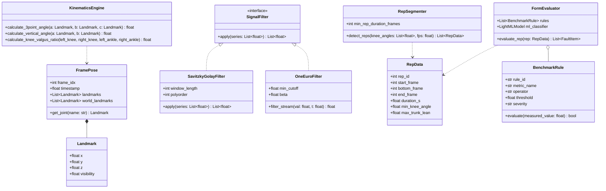

# ĐẶC TẢ CHI TIẾT: PHÂN TÍCH THIẾT KẾ HỆ THỐNG (UML & DATABASE)

---

## 1. BIỂU ĐỒ USE CASE (USE CASE DIAGRAM)

Biểu đồ Use Case mô tả trực quan các tác nhân (Actors) và các chức năng mà hệ thống cung cấp.

### 1.1. Các Tác nhân trong Hệ thống (Actors)
1. **Người tập Gym (Primary Actor):** Người trực tiếp sử dụng ứng dụng để phân tích động tác, tập luyện với gương thông minh và nhận lời khuyên từ HLV AI.
2. **Huấn luyện viên / Quản trị viên (Secondary Actor):** Quản lý bộ quy tắc tiêu chuẩn bài tập, giám sát hệ thống và xem báo cáo thống kê.
3. **Hệ thống AI / Agent (System Actor):** Thực hiện tự động các tác vụ nặng: xử lý video, tính toán sinh cơ học, tra cứu y văn RAG và sinh lời khuyên.

### 1.2. Sơ đồ Use Case Tổng thể

### 1.3. Đặc tả Use Case Tiêu biểu (Use Case Specification)

* **Tên Use Case:** `Phân tích Video Động tác (Analyze Exercise Video)`
* **Mã số:** `UC-02`
* **Tác nhân chính:** Người tập Gym.
* **Tác nhân hỗ trợ:** Hệ thống AI / Background Worker.
* **Tiền điều kiện:** Người dùng đã đăng nhập và chọn một bài tập hợp lệ (ví dụ: Squat).
* **Luồng sự kiện chính (Basic Flow):**
  1. Người dùng chọn file video (.mp4) từ máy tính/điện thoại và nhấn "Bắt đầu phân tích".
  2. Hệ thống kiểm tra điều kiện kỹ thuật của video (độ phân giải $\ge 720p$, FPS $\ge 30$, thời lượng $3 - 60$ giây).
  3. Hệ thống lưu video, tạo mã phiên phân tích (`analysis_id`), và hiển thị màn hình chờ xử lý.
  4. Hệ thống chạy tiến trình ngầm: trích xuất 33 khớp, làm mượt, tính góc, tách rep, đối chiếu tiêu chuẩn và kích hoạt Multi-Agent.
  5. Hệ thống hoàn tất và điều hướng người dùng tới trang kết quả trực quan (Video Overlay + 3D Viewer + Lời khuyên HLV).
* **Luồng ngoại lệ (Alternative Flow):**
  * *2a. Video không đạt chuẩn (FPS quá thấp hoặc không nhận diện được người):* Hệ thống hiển thị cảnh báo lỗi cụ thể bằng tiếng Việt và yêu cầu người dùng tải lại video đúng hướng dẫn.

---

## 2. THIẾT KẾ CƠ SỞ DỮ LIỆU (DATABASE ERD SCHEMA)

Cơ sở dữ liệu được thiết kế theo chuẩn hóa dạng chuẩn 3 (3NF), đảm bảo tính toàn vẹn dữ liệu và hỗ trợ tốt cho việc lưu trữ chuỗi thời gian phân tích thể thao.

### 2.1. Sơ đồ Thực thể - Mối quan hệ (ERD Diagram)

---

## 3. BIỂU ĐỒ TUẦN TỰ (SEQUENCE DIAGRAM)

Mô tả sự tương tác động giữa các thành phần phần mềm theo dòng thời gian.

### 3.1. Luồng 1: Phân tích Video Bài tập (Tải lên $\rightarrow$ Xử lý CV $\rightarrow$ AI Báo cáo)

### 3.2. Luồng 2: Chat Hỏi đáp Chuyên sâu với Huấn luyện viên AI

---

## 4. BIỂU ĐỒ HOẠT ĐỘNG (ACTIVITY DIAGRAM)

Biểu đồ hoạt động mô tả luồng công việc logic từ đầu đến cuối của toàn bộ quy trình phân tích:

---

## 5. BIỂU ĐỒ LỚP (CLASS DIAGRAM) — LÕI XỬ LÝ SINH CƠ HỌC

Thiết kế hướng đối tượng (OOP) cho các mô-đun cốt lõi trong thư mục `backend/app/core/`:

